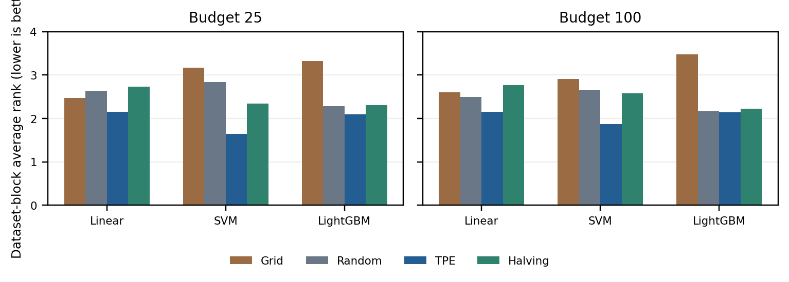
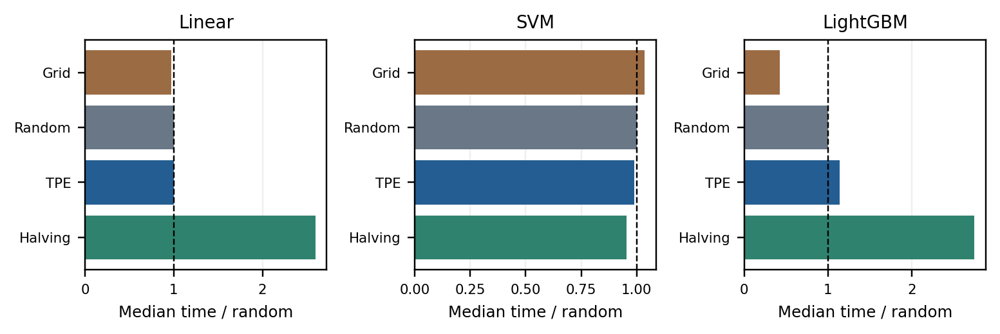
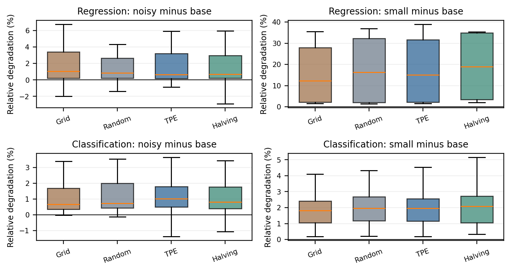

# Budgeted Hyperparameter Optimization on Tabular Data: Predictive Performance, Computational Cost, and Robustness

**MAP 6114 Machine Learning**

**Team: Optima Prime**

Danay Fernandes Alfonso  
Dilek Ozdemirci  
Ecil Teodoro

---

# Budgeted Hyperparameter Optimization on Tabular Data: Predictive Performance, Computational Cost, and Robustness

## Abstract

We compared four hyperparameter tuning methods on regression and classification tasks, using tabular data: grid search, random search, Bayesian optimization with a tree-structured Parzen estimator (TPE), and successive halving. We tuned three kinds of models: linear models, support vector machines (SVM) with a radial basis function (RBF) kernel, and LightGBM. The study covered 51 combinations of dataset, condition, and model. Each combination was run at two search budgets with a target of five seeds. We first planned ten seeds but cut it to five because the runs took too long. All saved searches added up to 164.70 hours on a 16-core Apple M4 Max with 128 GB of RAM. That total covers 1,614 unique completed runs from three versions of our code. The main analysis uses only one code version, which accounts for 135.72 hours and for 448 of the 510 planned comparisons that have results from all four optimizers. TPE had the best average rank in every model-budget group, and its lead was largest for SVM. For the linear models, though, the test scores were often almost the same no matter which optimizer we used. Halving did not reliably save time, and a bigger budget did not always give better test results. Adding label noise or shrinking the training set usually made predictions worse. Some comparisons are missing, some fits had convergence warnings, and the grids and resource use were not built the same way for every method. Because of this, we report the scores and costs we observed and do not claim that any optimizer is statistically better overall.

*Index terms:* hyperparameter optimization; random search; Bayesian optimization; successive halving; tabular learning; computational budgets.

## I. Introduction

Tuning hyperparameters often takes much longer than training a single model. A regularization strength, kernel setting, or tree setting that works well on one dataset can work badly on another. Our team wanted to see when a simple search is good enough and when an adaptive method is worth the extra effort.

To look at this, we compared four search methods on six real datasets and four synthetic ones. Together they include regression and classification, small and large sample sizes, few and many features, and balanced and imbalanced classes. We also changed the training data in two ways, by adding noise and by using fewer samples, to see how the methods held up. Within each comparison, every optimizer got the same data split, the same cross-validation folds, and the same seed.

Our main questions were **which method gives better test predictions**, **what happens when the budget goes from 25 to 100**, and **how long each method takes**. We also looked at how much the results moved between seeds and whether our conclusions changed under other metrics. The results we have answer some of these questions, but not all of them, since some planned comparisons are still missing.

The computing time forced us to change the plan. We went from ten seeds to five, which cut the planned optimization runs from 3,060 to 1,530. Even so, the main five-seed group used 135.72 hours of recorded search time without being complete. Run one after another, that is 5.65 days. If we include the older code versions, the total goes up to 164.70 hours, or 6.86 days. Everything ran on a 16-core Apple M4 Max with 128 GB of RAM, and we kept five-fold cross-validation and both budgets.

There is one more difference from our proposal. The proposal described giving each method the same amount of time. What we actually did was limit the number of full evaluations (or a rough equivalent for halving) and record the elapsed time separately. This matters, since two methods can use about the same number of evaluations and still take very different amounts of time.

## II. Related Work

### A. Random and Bayesian search

Bergstra and Bengio [1] show why random search can be a better choice than a grid. If only a few hyperparameters really affect performance, a grid wastes a lot of trials changing the ones that don't. This was our reason for including random search as a baseline, especially for LightGBM, which has a bigger search space.

Bergstra et al. [2] describe sequential methods that use past results to pick the next configuration to try, including the approach behind TPE. For our Bayesian optimization runs we used Optuna's TPE sampler. So our results are about this specific implementation and not about every method that gets called Bayesian optimization.

### B. Allocating resources during a search

Jamieson and Talwalkar [3] treat hyperparameter search as a problem of finding a good candidate while also deciding how much computing each candidate should get. This is the idea behind successive halving: try many candidates cheaply, then give more resources to the ones that look good. Whether it actually saves time depends in part on how well the early scores predict the final ones.

Li et al. [4] introduce Hyperband, which adds several choices about how many candidates to start with and how much to spend on each. Our code only uses one fixed three-stage halving schedule. We did not implement Hyperband's multiple brackets, so our halving results should not be read as Hyperband results.

### C. Tuning, evaluation, and model choice

Probst, Boulesteix, and Bischl [5] looked at how much tuning actually helps different algorithms, and their work changed how we read our own ranks. In our Credit Default results, for example, all four optimizers got a linear-model AUC of about 0.71955. One of them still has to be ranked first, but that "win" means almost nothing in practice.

Bischl et al. [6] cover search algorithms, but also the practical side of tuning: evaluation, preprocessing, parameter ranges, and parallel runs. The point we took most directly from them was about preprocessing. If the median used to fill missing values or the mean used for standardizing is computed on the whole training set, the validation fold has already "seen" part of itself, and the CV score looks better than it should. So in our code, every fold computes these values from its own training part only. We also kept the test set completely out of parameter selection and saved the search settings for every run.

Demšar [7] discusses how to compare several learning algorithms statistically over many datasets. We based our planned Friedman and post-hoc tests on this paper, and it is also why we did not treat different seeds as independent datasets. We have not reported formal test results yet, because our coverage and convergence checks are not met.

Ke et al. [8] present LightGBM, a fast gradient-boosted tree method. Its large parameter space makes it a useful contrast to the linear models and SVM. Optuna [9] provides our TPE search, and Scikit-learn [10] provides the other estimators, preprocessing, folds, and scoring functions. Grinsztajn, Oyallon, and Varoquaux [11] study model performance on tabular data while taking tuning and model assumptions into account. Their work supports comparing several model families, but it also reminds us that the model type and the size of the search space change together.

## III. Methodology

### A. Datasets and experiment design

We planned 19 dataset-condition combinations and 51 dataset-condition-model combinations, which we call cells. Linear models and LightGBM have 19 cells each. SVM has 13, because we left it out of the Base and Noisy conditions for the larger datasets. Every cell has four optimizers, budgets of 25 and 100, and five seeds. In total the design needs 1,530 optimization runs and gives 2,040 budget summaries. There are fewer runs than summaries because random search and TPE use one search history for both budgets.

**Datasets and training conditions. Row and feature counts are source values before cleaning.**

| Dataset (OpenML ID) | Task | Rows | Features | Conditions |
| --- | --- | --- | --- | --- |
| White Wine (44971) | Reg. | 4,898 | 11 | Base, Noisy |
| Superconductivity (44964) | Reg. | 21,263 | 81 | Base, Small, Noisy |
| Communities/Crime (46286) | Reg. | 1,994 | 122 | Base, Noisy |
| Bank Marketing (1461) | Class. | 45,211 | 16 | Base, Small, Noisy |
| Bioresponse (4134) | Class. | 3,751 | 1,776 | Base, Noisy |
| Credit Default (42477) | Class. | 30,000 | 23 | Base, Small, Noisy |
| Four synthetic generators | Both | 2,000 each | 20 | Base |

Table I gives the row and feature counts of the original datasets, before our cleaning and encoding. For Bank Marketing, we dropped call duration, since it is only known after the call is over. For Communities and Crime, we dropped the identifiers and a fixed list of problem attributes, then converted everything left to numbers. For Credit Default, we dropped the identifier and treated some integer-coded columns as categories. Because of these steps, the number of inputs a model actually sees can be different from the source feature count. The table is not meant as a new audit of every dataset property.

For each seed, we first held out 20% of the data as a test set. Classification splits were stratified so the class proportions stayed the same. The Base condition uses all the remaining training data. The Small condition cuts the training set down to 2,000 observations, sampled with stratification by class or by quantiles of the regression target. We only used Small for Superconductivity, Bank Marketing, and Credit Default.

In the Noisy condition, we only changed the training labels. For regression, we added Gaussian noise with standard deviation $0.5\,s_{y,\text{train}}$, where $s_{y,\text{train}}$ is the standard deviation of the training target. For classification, we flipped 10% of the training labels. For a given dataset and seed, Base, Small, and Noisy all share the same clean test set, so comparing them shows the effect of changing only the training data.

Each synthetic task has 2,000 observations and 20 features. The linear regression generator has ten informative features and a target-noise standard deviation of 10. The Friedman generator has five informative features and a noise standard deviation of 1. The classification generators have five informative and five redundant features, a label-reassignment rate of 0.01, and either about equal classes or a nominal 90:10 split. We generated a new dataset for each seed. The synthetic tasks only use Base, and the generator's built-in noise is added before the split, so it is in both the training and test data.

### B. Models and preprocessing

For regression we used Elastic Net, and for classification we used elastic-net logistic regression with the SAGA solver. We call both of these the linear-model family. The SVM uses an RBF kernel, with probability estimates turned on for classification. LightGBM gives us gradient-boosted tree models for both regression and classification [8]. Because SVM is slow to train, we only ran it on the smaller datasets and the Small conditions.

For numeric features, we filled missing values with the median and then standardized. For categorical features, we filled missing values with the most common category and used one-hot encoding that can handle categories it has not seen before. These steps were fit separately inside each cross-validation training fold, so the validation fold never affected the preprocessing.

LightGBM used the same preprocessing. We thought about using its built-in categorical handling, but did not end up implementing it. The models also differ in more ways than just the number of parameters we tune. That means we can compare how the optimizers behave across model families, but we can't explain every difference by the size of the search space alone.

**Hyperparameter ranges used by the searches. For halving, LightGBM tree count is set by the resource stage.**

| Model / group | Parameters and bounds |
| --- | --- |
| Linear / regression | alpha: 0.0001-100 (log); l1_ratio: 0.05-1 |
| Linear / classification | C: 0.0001-100 (log); l1_ratio: 0-1; class_weight: none/balanced |
| SVM / both | C: 0.001-1000 (log); gamma: 0.00001-1 (log) |
| SVM / task-specific | epsilon: 0.001-1 (log, regression); class_weight: none/balanced (classification) |
| LightGBM / structure | num_leaves: 8-128; max_depth: -1, 3, 5, 8, 12; min_child_samples: 5-100 |
| LightGBM / sampling | subsample: 0.5-1; colsample_bytree: 0.5-1 |
| LightGBM / boosting | learning_rate: 0.01-0.3 (log); n_estimators: 50-500 |
| LightGBM / regularization | reg_alpha and reg_lambda: 0.000001-10 (log); min_split_gain: 0-1 |

The linear models have two or three tunable parameters, SVM has three, and LightGBM has ten in the full setup. Table II lists the ranges, and values marked logarithmic are sampled on a log scale. Elastic Net for regression can run up to 50,000 iterations, and the classification version up to 10,000. We saved convergence warnings instead of automatically throwing out those candidates. Because of this, some of the selected models still have warnings. We report how many, and we include a separate table that only uses comparisons where neither the selected fit nor the refit had a warning.

### C. Search methods and budgets

For grid search, our code builds the largest rectangular grid that fits inside the budget. This has a side effect that matters later in the results: if a parameter ends up with only one value on the grid, the code just takes the first category or the lower end of the range, and that isn't always the model's default. Random search is simpler and just draws from the ranges in Table II. TPE is the only one of the three that looks back at the validation scores so far before choosing its next candidate [2], [9]. In all four methods the trials run one after another, so the only parallel work happens inside a trial, where the five CV folds are fit at the same time.

Our successive-halving code starts with randomly sampled candidates and uses three resource levels, $r \in \{1/9, 1/3, 1\}$. After each stage, roughly a third of the candidates move on. For linear models and SVM, the resource is the size of the training fold. The subsets are nested, and the validation folds do not change. For LightGBM, the resource is the number of boosting rounds, which reaches the maximum of 500 in the last stage. At each stage we fit the candidates from scratch instead of continuing from the earlier fit. Only candidates that were evaluated at full resource can be picked for the final refit.

We count how much resource halving uses as

$$B_{\text{used}} = \sum_{j=1}^{J} r_j.$$

Here, one full evaluation means testing one configuration on all five CV folds, not fitting one model once. The saved halving schedules use 24 and 99 full-evaluation equivalents for the nominal budgets of 25 and 100. The LightGBM grids test 24 and 96 configurations. Every LightGBM grid configuration selected in this snapshot has 50 trees. So even with the same nominal budget, the methods do not do exactly the same amount of fitting or cover the parameters in the same way.

Random search and TPE each run for 100 trials. To get their budget-25 result, we take the best of the first 25 trials, and we refit the chosen configuration separately for each budget. Grid and halving are run separately at each budget, because their search designs change with the budget. The two summaries that come from one shared history are related to each other, and adding up their times would count part of the same search twice.

### D. Model selection, scores, and hardware

We used the same five cross-validation folds for every optimizer, so all four searches were judged on exactly the same splits. Regression was scored with RMSE and classification with ROC-AUC. If you open our output files, you'll notice RMSE is saved as a negative number during the search. Scikit-learn always maximizes its scores, so it flips the sign of error metrics; we flip it back in the summary tables. After the search picked a winner, we retrained it on all of the training data and scored it once on the clean test set.

We also saved mean absolute error (MAE) for regression, and F1, average precision (AP), and log loss for classification. F1 combines precision and recall using each model's default decision threshold. AP summarizes how precision and recall trade off as the threshold changes. It is not the trapezoid-rule area under a precision-recall curve. Log loss looks at the predicted probabilities and penalizes confident wrong answers.

For comparisons where lower should always be better, we define the test loss as

$$\ell = \begin{cases} \text{RMSE}, & \text{regression},\\ -\text{ROC-AUC}, & \text{classification}. \end{cases}$$

The gain from the bigger budget is $g = \ell_{25} - \ell_{100}$. A positive gain means the budget-100 model did better on the test set. We define the generalization gap as test RMSE minus validation RMSE, or validation AUC minus test AUC, so a positive gap means the test result was worse. In the Noisy condition, validation uses the changed training labels and testing uses the clean labels, so the gap there is not purely a measure of overfitting.

All experiments ran on a 16-core Apple M4 Max with 128 GB of RAM. The main analysis group used four parallel CV workers with one native model thread each. We did not check whether all 16 cores were actually busy. The recorded optimization time includes the search and CV work, but not downloading data or the final refits. Search overhead, fitting cost, and other programs running on the machine can all affect elapsed time. We did not measure CPU usage or energy, and multiplying elapsed hours by the number of cores would not give a real CPU-hour total. Software versions are listed in Appendix A.

### E. Matching runs and comparing methods

We only include a comparison when all four optimizers have results for the same dataset, condition, model, budget, and seed. Within that group, we rank their test losses from 1 to 4, and ties get the average rank. So that datasets with more conditions don't count more, we first average the seed ranks within each condition, then average the conditions within each dataset. The four synthetic generators are closely related, so we treat them as one synthetic-family block. The final model-budget averages are taken over these dataset blocks. We never average raw RMSE across datasets, since their targets are on different scales.

Our planned statistics are Friedman tests across blocks, a Holm correction across the six model-budget tests, and Nemenyi comparisons when the corrected omnibus test is significant [7]. Before running the tests on a panel, we require all planned cells and seeds, passing convergence checks for the selected trials and refits, and at least five blocks. Right now, no panel meets all of these. Because of this, we do not report any p-values or claim statistical significance. Even if the study were complete, there would only be seven benchmark blocks, so the tests would have limited power and the large-sample approximations would have to be used carefully.

We also compare test performance and time using Pareto efficiency. In a matched group, a method is Pareto efficient if no other method is at least as good on both test loss and time while being strictly better on one of them. This shows which combinations of speed and accuracy were useful in our results. It does not let anyone pick a method for new data by looking at that data's test set.

Some plots show differences relative to the absolute value of a reference score. A relative change in AUC is not the same as a change in AUC percentage points, and it also does not mean the same thing as a relative change in RMSE. We use these plots to describe the results, not as a shared effect-size scale.

## IV. Results

### A. Available runs

The October 30 snapshot has 1,619 saved JSON files. Of these, 1,618 are marked complete and one was interrupted. They come from three versions of the source code. We keep the versions apart when comparing performance, because the execution settings changed between them and some older files are missing model and convergence details.

The biggest eligible group, whose source hash starts with 5f5b6e60da15..., is the one we use for the main analysis. We picked it because it had the most coverage, not because it was necessarily the newest. After removing duplicates, it has 1,345 completed runs and 1,793 budget summaries. Across all three versions there are 1,614 unique completed runs, and four of the completed files are just copies of other results.

**Available comparisons with all four optimizers in the main analysis group. Dataset counts include all model cells and budgets.**

| Dataset | Available / planned | Coverage |
| --- | --- | --- |
| Bank Marketing | 56 / 70 | 80.0% |
| Bioresponse | 58 / 60 | 96.7% |
| Communities/Crime | 48 / 60 | 80.0% |
| Credit Default | 70 / 70 | 100.0% |
| Superconductivity | 56 / 70 | 80.0% |
| Balanced synthetic | 30 / 30 | 100.0% |
| Friedman | 30 / 30 | 100.0% |
| Imbalanced synthetic | 30 / 30 | 100.0% |
| Synthetic linear | 30 / 30 | 100.0% |
| White Wine | 40 / 60 | 66.7% |

We have 448 comparisons where all four optimizers are present, or 1,792 matched summaries, out of 510 planned groups. That is 87.8% coverage. Among the dataset-condition-model-budget panels, 48 have all five seeds, 52 have four, and two have none. The two empty panels are White Wine Base SVM at both budgets. Those experiments do have older files, but no results in the main code-version group. One more primary summary does not have a full four-optimizer group, so we left it out of the comparison plots.

Table III shows where the gaps are. The average ranks could change once more compatible results are added, so the current values only describe the comparisons we have.

### B. Test performance

**Average test ranks after grouping by dataset, with seven blocks per model-budget panel. Lower ranks are better.**

| Model | B | Grid | Random | TPE | Halving |
| --- | --- | --- | --- | --- | --- |
| Linear | 25 | 2.473 | 2.642 | 2.158 | 2.728 |
| Linear | 100 | 2.596 | 2.490 | 2.148 | 2.766 |
| SVM | 25 | 3.164 | 2.839 | 1.650 | 2.346 |
| SVM | 100 | 2.914 | 2.645 | 1.864 | 2.577 |
| LightGBM | 25 | 3.320 | 2.282 | 2.088 | 2.310 |
| LightGBM | 100 | 3.471 | 2.169 | 2.136 | 2.224 |

In Table IV, TPE has the best average rank in all six model-budget groups. The gap is biggest for SVM, where TPE's ranks are 1.650 at budget 25 and 1.864 at budget 100, while random search gets 2.839 and 2.645. For LightGBM at budget 100, TPE, random, and halving are close together, with ranks of 2.136, 2.169, and 2.224. Grid comes last for LightGBM at both budgets, but its limited grid and fixed 50 trees should be kept in mind when reading that result.

**Figure 1.** Average optimizer ranks across seven dataset blocks. Some cells have missing seeds. A rank does not show how large the score difference is.

**Example Base-condition test scores at budget 100. Mean and standard deviation (SD) use the available seeds. Regression scores are RMSE; classification scores are ROC-AUC.**

| Dataset / model | Optimizer | Seeds | Mean | SD |
| --- | --- | --- | --- | --- |
| Synthetic linear / Linear | Grid | 5 | 10.23333 | 0.37028 |
|  | Random | 5 | 10.23416 | 0.34965 |
|  | TPE | 5 | 10.22446 | 0.36416 |
|  | Halving | 5 | 10.23428 | 0.35334 |
| Synthetic linear / LightGBM | Grid | 5 | 46.78261 | 7.74061 |
|  | Random | 5 | 35.80414 | 5.19845 |
|  | TPE | 5 | 34.28479 | 6.47163 |
|  | Halving | 5 | 36.65876 | 7.04891 |
| Friedman / LightGBM | Grid | 5 | 1.42058 | 0.02528 |
|  | Random | 5 | 1.29222 | 0.03576 |
|  | TPE | 5 | 1.27173 | 0.03614 |
|  | Halving | 5 | 1.33959 | 0.03195 |
| Superconductivity / LightGBM | Grid | 4 | 9.72079 | 0.34208 |
|  | Random | 4 | 9.24376 | 0.31994 |
|  | TPE | 4 | 9.32176 | 0.40002 |
|  | Halving | 4 | 9.17557 | 0.34985 |
| Credit Default / Linear | Grid | 5 | 0.71955 | 0.00511 |
|  | Random | 5 | 0.71955 | 0.00511 |
|  | TPE | 5 | 0.71955 | 0.00511 |
|  | Halving | 5 | 0.71955 | 0.00510 |
| Bioresponse / LightGBM | Grid | 5 | 0.88306 | 0.00767 |
|  | Random | 5 | 0.88686 | 0.00643 |
|  | TPE | 5 | 0.88668 | 0.01162 |
|  | Halving | 5 | 0.88829 | 0.00945 |

The raw scores in Table V show that a better rank doesn't always mean a meaningful improvement. On synthetic linear regression with Elastic Net at budget 100, all four methods are within 0.010 RMSE of each other. TPE gets 10.224 and random search gets 10.234. On the same data, LightGBM gets an RMSE of 34.285 with TPE and 46.783 with grid. In this case, picking a model that fits the data matters a lot more than picking the optimizer. That grid result should also be read with its fixed tree count and limited parameter coverage in mind.

For Friedman regression with LightGBM, TPE reaches an RMSE of 1.272, random search 1.292, halving 1.340, and grid 1.421. On Superconductivity Base the order is different: halving has the best mean LightGBM RMSE at 9.176, then random at 9.244 and TPE at 9.322. So TPE's better overall rank doesn't mean it wins on every dataset.

The linear model on Credit Default Base shows an especially tiny difference, with all four AUC means at about 0.71955. We can still rank these scores, but the order says very little about any real improvement. Table V also gives the standard deviations across seeds, so the means can be read together with how much they vary.

### C. What the larger budget changed

Going from a budget of 25 to 100 did not always improve the test predictions. For LightGBM on regression tasks, TPE improved RMSE in 29 of 38 matched budget pairs (76.3%), with a median relative improvement of 1.27%. Random search improved in 25 of 38 pairs (65.8%), with the same median of 1.27%. Halving improved in only 16 of 38 pairs (42.1%), and its median gain was zero. Its budget-100 run is a completely separate search, so it doesn't necessarily keep the winning candidate from the smaller run.

For LightGBM on classification, the median relative AUC gains go from 0.055% for random search to 0.168% for halving. These two improve in 25 of 47 and 31 of 47 matched pairs. For the linear models, the median gains are mostly zero or very close to zero. SVM grid search improves on classification in 25 of 29 pairs (86.2%) but still has a worse average rank than TPE. Figure 2 shows both the improvements and the cases where results got worse.

**Figure 2.** Test-score changes from budget 25 to 100, relative to the magnitude of the budget-25 score. Positive values mean improvement. Boxplots use the available matched groups, with outlier markers hidden. Relative AUC and RMSE changes have different interpretations.

### D. Search time and total computing cost

**Median runtime relative to random search at budget 100, and the percentage of matched groups where each method is Pareto efficient.**

| Model | Optimizer | Time / RS | Pareto | Groups |
| --- | --- | --- | --- | --- |
| Linear | Grid | 0.97 | 56.0% | 84 |
| Linear | Random | 1.00 | 48.8% | 84 |
| Linear | TPE | 1.00 | 61.9% | 84 |
| Linear | Halving | 2.59 | 17.9% | 84 |
| SVM | Grid | 1.04 | 29.1% | 55 |
| SVM | Random | 1.00 | 49.1% | 55 |
| SVM | TPE | 0.99 | 72.7% | 55 |
| SVM | Halving | 0.96 | 61.8% | 55 |
| LightGBM | Grid | 0.43 | 94.1% | 85 |
| LightGBM | Random | 1.00 | 74.1% | 85 |
| LightGBM | TPE | 1.14 | 61.2% | 85 |
| LightGBM | Halving | 2.75 | 35.3% | 85 |

At budget 100, TPE takes about as long as random search for the linear models, with a median time ratio of 1.00. The ratio is 0.99 for SVM and 1.14 for LightGBM. Halving takes 2.59 times as long as random search for the linear models and 2.75 times as long for LightGBM. For SVM it is a little faster, with a ratio of 0.96. Table VI shows these matched ratios.

So our halving schedule did not save time in general. Some likely reasons are the repeated fitting at each stage, the number of candidates evaluated, and the overhead of training on fractions of the data. Our saved results can't separate how much each of these contributes.

LightGBM grid search only takes 0.43 times the random-search time at budget 100. But that speed comes with the worst average rank and the limited 50-tree grid we described earlier. Even so, grid is Pareto efficient in 94.1% of matched groups, because being fast can make it a reasonable tradeoff. The numbers for the other methods are 74.1% for random search, 61.2% for TPE, and 35.3% for halving. These percentages count matched seed groups, while the ranks in Table IV weight each dataset block equally. That difference in weighting is part of why the two don't give the same order.

**Figure 3.** Median search time relative to random search at budget 100. The dashed line marks equal time. Our halving schedule does not generally save elapsed time.

#### Adding up the recorded time

To find the project's total recorded search time, we went through all 1,619 result files. After removing four byte-identical copies, we had 1,614 unique completed runs, plus one interrupted run that had no timing checkpoint. For each run $i$, we took its last recorded cumulative time, $T_i = \max_j t_{ij}$. If a run was missing trial timing, we used the largest optimization time among its budget summaries instead. Then we added up the run times:

$$T_{\text{recorded}} = \sum_i T_i.$$

We did not add up the cumulative timestamps inside a run, and we did not add both overlapping budget summaries for random search and TPE. The audit script checks duplicate run IDs against file-content hashes and keeps a list of every file it read.

The total comes to 592,915.22 seconds, or 164.70 hours. That would be 6.86 days if all the recorded runs had been done one after another. The main five-seed group makes up 135.72 hours, and the older code versions make up 28.98 hours. We don't know how long the interrupted run took, so we did not count it as zero.

The 164.70 hours should be read as a lower bound on the work, not as how long the project actually took. The script only counts time while a search was running, so things like downloading the data, the final refits, and runs that stopped before saving a checkpoint aren't in it. The one exception to the lower-bound reading is overlap: if two batches ran at the same time, their hours get added together even though they shared the same stretch of real time. We also want to be clear that these are elapsed hours, not CPU-hours.

**Recorded search time by dataset, including all conditions, models, budgets, and seeds. Main refers to the group used for performance analysis; All also includes older code versions. Duplicate copies are counted once.**

| Dataset | All hours | Main hours | Share of all |
| --- | --- | --- | --- |
| Bioresponse | 130.26 | 113.56 | 79.09% |
| Bank Marketing | 13.39 | 8.02 | 8.13% |
| Superconductivity | 12.26 | 8.00 | 7.44% |
| Credit Default | 3.23 | 3.23 | 1.96% |
| White Wine | 2.98 | 0.57 | 1.81% |
| Communities/Crime | 1.46 | 1.22 | 0.89% |
| Balanced synthetic | 0.31 | 0.31 | 0.19% |
| Imbalanced synthetic | 0.30 | 0.30 | 0.18% |
| Friedman | 0.27 | 0.27 | 0.16% |
| Synthetic linear | 0.23 | 0.23 | 0.14% |
| Total | 164.70 | 135.72 | 100.00% |

Most of the time went to Bioresponse: 130.26 hours, or 79.09% of the total. Bank Marketing took 13.39 hours (8.13%) and Superconductivity took 12.26 hours (7.44%). All four synthetic tasks together took only 1.11 hours. Table VII lists the other datasets and shows the main analysis group separately from the full archive.

Bioresponse doesn't have many observations, but it has 1,776 source features. It is a good example of why a small dataset isn't always cheap to tune. The linear models used 104.74 hours on Bioresponse alone and 123.88 hours (75.22%) across all datasets. From these totals we can't tell how much of that came from convergence problems or from particular parameter settings.

**Recorded search time by optimizer. Counts are unique completed runs. Grid and halving run separately at each budget; random search and TPE share their histories.**

| Search algorithm | Runs | All hours | Main hours | Share of all |
| --- | --- | --- | --- | --- |
| Grid | 538 | 49.37 | 39.88 | 29.98% |
| Random | 269 | 43.86 | 36.29 | 26.63% |
| Halving | 538 | 42.14 | 37.22 | 25.59% |
| TPE | 269 | 29.32 | 22.33 | 17.80% |
| Total | 1614 | 164.70 | 135.72 | 100.00% |

By search method, grid used 49.37 hours, random search 43.86 hours, halving 42.14 hours, and TPE 29.32 hours (Table VIII). These totals just describe the work we recorded. They are not a fair speed ranking of the optimizers. Grid and halving have separate runs for each budget, while random search and TPE share one history. Dataset coverage, the cost of each configuration, and execution settings also change between code versions. For comparing runtimes under the main setup, the matched ratios in Table VI are a better guide.

**Recorded search time by model family. Workloads differ, and SVM is excluded from the larger Base and Noisy conditions.**

| Model family | Runs | All hours | Main hours | Share of all |
| --- | --- | --- | --- | --- |
| Linear | 624 | 123.88 | 100.64 | 75.22% |
| SVM | 420 | 25.17 | 22.65 | 15.28% |
| LightGBM | 570 | 15.64 | 12.44 | 9.50% |
| Total | 1614 | 164.70 | 135.72 | 100.00% |

By model family, the linear models used 123.88 hours, SVM 25.17 hours, and LightGBM 15.64 hours (Table IX). SVM was never run on the large Base and Noisy datasets, so its smaller total doesn't show that it scales better. The main five-seed group by itself took more than five days of back-to-back search time, which backs up our choice to cut the number of seeds. We have not tried to estimate an exact total for ten seeds, because the cost and coverage change from seed to seed and from cell to cell.

### E. Noise and smaller training sets

In the condition comparisons, the test set is always clean and stays the same. Adding noise to the training labels usually made test results worse, although a few individual comparisons got better. Those cases could just be random variation between repeats or a different configuration being picked by the search. They don't mean that corrupting labels helps in general.

For regression, the median relative drop in performance from Base to Noisy goes from 0.67% for TPE to 1.04% for grid, with 56 matched comparisons per method. For classification, it goes from 0.67% for grid to 1.02% for TPE, with 64 comparisons per method.

Using a smaller training set had a bigger effect on the regression results we have. The median relative drop goes from 12.32% for grid to 18.99% for halving, over 16 comparisons per method. All of these regression comparisons come from Superconductivity and the two model families that were run in both conditions, so they are not results from several independent regression datasets. For classification, the Small effects range from 1.81% to 2.09% over 36 comparisons per method. These pooled percentages mix repeated models, budgets, and tasks on different scales, so they should not be treated as standardized effects that can be compared directly across tasks.

**Figure 4.** Changes in clean-test performance after altering the training data. Positive values mean worse performance. Both budgets and available model cells are included; outlier markers are hidden. The Small regression comparisons use Superconductivity only.

### F. Other metrics and variation between seeds

The imbalanced synthetic SVM task is a good example of why the choice of metric matters. At budget 100, halving has the highest mean ROC-AUC (0.9419) and the lowest log loss (0.1435). TPE has the highest AP (0.7859) and F1 (0.6618). Random search gets an ROC-AUC of 0.9382, AP of 0.7742, F1 of 0.6492, and log loss of 0.1521. So the method with the best ROC-AUC isn't necessarily the best on AP, F1, or log loss, since each metric looks at a different part of prediction quality.

The results also vary quite a bit across the five seeds. TPE's standard deviation is 0.1349 for AP and 0.1580 for F1, which is large next to the differences between the mean scores in this example. Seed variation includes both changes in the data split and randomness in the search, and for the synthetic tasks it also includes generating a new dataset. A standard deviation across seeds is not a confidence interval for one fixed dataset, and it doesn't show that two optimizers are equivalent. The tables that come with this paper keep the standard deviations and secondary metrics for every cell we have.

### G. Search progress, generalization, and convergence

**Figure 5.** Best validation RMSE so far for Friedman regression with LightGBM, seed 1, budget 100. Only full-resource trials update the score, but time and resource totals include earlier low-resource work. This is one example, not a comparison of convergence rates across datasets.

Figure 5 follows Friedman regression with LightGBM at seed 1 and budget 100. We picked it as an example of nonlinear regression, not because it was the best-looking seed. The curves show the best validation score found so far against cumulative resource and against elapsed time. For halving, only full-resource trials can change that score, but the earlier trials still count toward time and resource. We did not keep re-checking the test set to draw these curves. One example like this can't tell us which method converges faster in general, so the analysis exports 224 matched high-budget panels for a closer look.

The saved generalization tables and validation-versus-test plots show gaps going both ways. For example, with LightGBM on Bioresponse Base, TPE's mean validation AUC is 0.8738 and its test AUC is 0.8867. On Credit Default Base, the same values are 0.7863 and 0.7806. Split variation and the selection process both affect these gaps. In the Noisy conditions, the difference between the corrupted validation labels and the clean test labels also plays a part.

Out of the 1,793 summaries in the main group, 53 have a convergence warning on the selected trial and 37 have one on the final refit. That is 2.96% and 2.06% of the summaries, and all of them are in the linear-model family. These are not counts of separate failed searches, because both budgets can end up selecting the same trial. SVM and LightGBM have no warnings on selected trials or refits, although having no warnings doesn't prove a model reached the global optimum.

The main results keep these completed fits and report the warnings. A separate sensitivity table only uses matched groups where every selected trial and refit passed the convergence checks. That way, readers can look at the warning-free comparisons without us quietly changing which results are in the main tables.

## V. Discussion and Limitations

The SVM results give the strongest reason to use TPE. The linear-model results give much less reason to put a lot of effort into any particular search method, since their raw scores are often almost the same even when their ranks are different. Random search is still a useful baseline. LightGBM shows bigger differences between methods on some nonlinear regression tasks, but which optimizer works best changes from dataset to dataset. Also, a better validation score doesn't guarantee a better test score.

Some of the biggest differences come from how we set up the searches. Our grid keeps single-value numeric parameters at their lower bounds and fixes LightGBM at 50 trees. Halving goes up to 500 trees, while random search and TPE sample anywhere from 50 to 500. All methods use the same listed ranges, but they don't explore the same candidates or do the same amount of fitting per unit of budget. Our results describe the searches as we implemented them. A follow-up study should rethink which parameters the grid prioritizes and make the tree counts and resource choices more similar before blaming all of the difference on the search algorithm.

Missing results are another limitation. We left out older code versions that had different or incomplete metadata, which made coverage uneven and left no White Wine Base SVM results in the main group. These gaps are not random. Filling in the compatible runs could change the average ranks. Five seeds also don't tell us much about variability, and repeated splits of one real dataset are not independent datasets. Our six real datasets were picked as examples, and the four synthetic tasks are related to each other. So the study can't show a general causal effect of search-space size, label noise, or optimizer choice.

We can't fully trust the timing numbers either. Each run used four CV workers with one thread each, but we never checked whether anything else was running on the machine at the same time, so some runs could look slower than they really were. The times also only cover the search itself. Downloading the data and the final refits aren't counted. At one point we also got a warning when the parallel workers shut down. We never figured out what caused it, and we can't completely rule out that it affected something, though nothing points to a memory leak or a scoring bug. As for the convergence warnings, we left the 53 selected-trial and 37 refit warnings in the results and flagged them instead of quietly removing those runs.

In practice, the real question is whether a score gain is big enough to be worth its cost and its variability. The Pareto results help describe that tradeoff after the fact, but choosing a model for new data still needs validation data. And since the classification metrics don't always agree, picking an optimizer also means knowing which kind of prediction quality matters for the task.

## VI. Timeline and Teamwork Plan

We held our Week 6 meeting on Zoom on September 26, 2026. As of the October 30 snapshot, the repository has dataset loaders, preprocessing inside the CV folds, model factories, and all four search methods. It also has atomic checkpoints so saved results can't get corrupted, reuse of runs that already finished, convergence diagnostics, and a fully executed analysis notebook. The work was split among the three team members as described below.

**Completed milestones and the proposed schedule for finishing the project.**

| Period | Milestone / next action |
| --- | --- |
| Week 6 | Scope and team coordination meeting (documented). |
| Weeks 7-9 | Runner, saved experiments, and executed analysis implemented. |
| Week 10 | Check report claims and submit the midterm PDF with cover letter. |
| Weeks 11-12 | Resolve feasible coverage/convergence issues and review grid/resource semantics. |
| Weeks 13-14 | Refresh a frozen snapshot; review results, limitations, and references. |
| Week 15 | Finalize the paper and team presentation. |

Table X shows the project milestones and the rest of the schedule. Ecil Teodoro did the coding. Danay Fernandes Alfonso chose the datasets and analyzed the results. Dilek Ozdemirci analyzed the results and wrote the documentation.

## VII. Conclusion

The main thing we learned is that a better rank is not the same as a better model. TPE did rank first in every group, and for SVM the gap was real: an average rank of 1.650 at budget 25 against 2.839 for random search. For the linear models, though, the "winner" was often decided by tiny differences, like the synthetic regression task where all four methods finished within 0.010 RMSE of each other. Two other results surprised us. Halving was supposed to save time, but at budget 100 it took about 2.6 to 2.75 times as long as random search for the linear models and LightGBM. And quadrupling the budget didn't reliably help either. For LightGBM on regression, halving improved in only 16 of 38 cases.

The cost of computing is what makes these differences matter in practice. The saved searches took 164.70 hours, including 135.72 hours for the main five-seed group, on a 16-core Apple M4 Max with 128 GB of RAM. Because of this, we lowered the target from ten seeds to five. More search time paid off in some experiments, but in others the gains were so small that they would be hard to justify on accuracy alone. For the linear models, a simple search was usually enough. For SVM, TPE gave a better reason to use an adaptive method. For LightGBM, we had to pay closer attention to the dataset and to the configurations each search could actually reach.

These conclusions are partial and descriptive, since some comparisons are missing, some linear-model fits have convergence warnings, and the LightGBM searches differ in tree count and parameter coverage. Within those limits, our study supports picking a search method based on how big and how consistent its test-score gains are compared to its cost. The method with the best rank is not automatically the most useful one if a simpler search gets almost the same predictions in less time.

The October 30 snapshot used in this paper is missing 185 planned runs from the main code-version group. Most are seed-1 experiments: 42 for Bank Marketing, 36 for Communities and Crime, 42 for Superconductivity, and 30 for White Wine outside its Base SVM cell. White Wine Base SVM is missing all five seeds, accounting for another 30 runs. Bioresponse Base is missing five seed-1 linear-model searches; halving at budget 100 is already available. Credit Default and the synthetic tasks have complete coverage. A batch is now filling these gaps, but its new results are not yet included in this paper.

To finish the project, we need to complete and check the compatible missing runs, review the linear-model convergence warnings, and rerun the analysis notebook on the expanded results. We also need to assess the LightGBM tree-count and grid-coverage differences and make any targeted reruns needed for a fairer comparison. Once the coverage and convergence requirements are met, we can run the planned Friedman tests, apply Holm correction, and carry out Nemenyi comparisons where appropriate. Finally, we must refresh the runtime audit, tables, figures, and report from the same results snapshot, revise the conclusions if the findings change, and prepare the final team presentation.

## Appendix A. Reproducibility and Evidence Map

This paper uses the executed October 30 snapshot of `notebooks/03_final_analysis.ipynb`. Writing and rebuilding the report does not rerun any tuning or change any experiment results. The exported tables, trajectory data, manifest, and analysis environment are in `report/data/`. The manifest file, `snapshot_manifest.json`, lists the selected files and their checksums.

The main source hash is 5f5b6e60da15ed1c5be07110bdfa0c1147b0502ee46a819fca83e9e5d938fdb4. The older groups start with 46fbb8ce4e07 and 89a4645b7b3c. We keep them separate in the performance comparisons because their dataset coverage and execution or model records are different. The main experiments used NumPy 2.5.3, pandas 3.0.6, Scikit-learn 1.9.1, Optuna 5.0.0, and LightGBM 4.7.0. The analysis environment is recorded separately.

The rank table (Table IV) comes from `table_03_average_ranks.csv`, the raw-score table (Table V) from `table_02_performance.csv`, and Table VI from `table_17_tradeoff_summary.csv`. Coverage and convergence counts come from tables 01 and 09. Budget changes are calculated from `budget_gains_per_cell_seed.csv`. Condition comparisons use table 12, secondary metrics use table 14, and historical run counts use table 21. The saved outputs also include generalization gaps, the warning-free sensitivity results, and raw differences from random search. The build script makes the paper's figures from this data and uses the same text and values for both the Markdown and LaTeX versions.

To redo the time audit, run `python report/scan_runtime.py`. It reads the saved runs and writes `runtime_summary.json`, ledgers of files and unique runs, and timing tables by dataset, optimizer, model, seed, and code version into `report/data/`. Older searches count toward the project's recorded computing cost, but their scores are not mixed into the main performance analysis. If the results folder changes, the timing text and tables have to be updated together.

To rebuild the report from the repository root, run `report/build_report.py` with Python in an environment that has pandas, NumPy, Matplotlib, Pandoc, and pdfLaTeX. The generated `report.tex` can also be compiled directly from `report/`. Input checksums are saved in `build_manifest.json`.

The planned run count is $51 \times 6 \times 5 = 1530$, and the planned summary count is $51 \times 4 \times 2 \times 5 = 2040$. The 448 complete comparison groups contain 1,792 summaries, which gives coverage of $448/510 = 87.8\%$. This is not the same as the share of completed files in the results folder. A legacy run that the runner can reuse is not automatically fit to be pooled into the analysis. Any new notebook snapshot means the paper has to be rebuilt and its numbers checked again.

## References

[1] J. Bergstra and Y. Bengio, "Random Search for Hyper-Parameter Optimization," Journal of Machine Learning Research, vol. 13, pp. 281-305, 2012. [Publisher / paper](https://jmlr.org/papers/v13/bergstra12a.html).

[2] J. Bergstra, R. Bardenet, Y. Bengio, and B. Kegl, "Algorithms for Hyper-Parameter Optimization," Advances in Neural Information Processing Systems, vol. 24, 2011. [Publisher / paper](https://proceedings.neurips.cc/paper/2011/hash/86e8f7ab32cfd12577bc2619bc635690-Abstract.html).

[3] K. Jamieson and A. Talwalkar, "Non-stochastic Best Arm Identification and Hyperparameter Optimization," Proceedings of AISTATS, PMLR, vol. 51, pp. 240-248, 2016. [Publisher / paper](https://proceedings.mlr.press/v51/jamieson16.html).

[4] L. Li, K. Jamieson, G. DeSalvo, A. Rostamizadeh, and A. Talwalkar, "Hyperband: A Novel Bandit-Based Approach to Hyperparameter Optimization," Journal of Machine Learning Research, vol. 18, no. 185, pp. 1-52, 2018. [Publisher / paper](https://jmlr.org/papers/v18/16-558.html).

[5] P. Probst, A.-L. Boulesteix, and B. Bischl, "Tunability: Importance of Hyperparameters of Machine Learning Algorithms," Journal of Machine Learning Research, vol. 20, no. 53, pp. 1-32, 2019. [Publisher / paper](https://jmlr.org/papers/v20/18-444.html).

[6] B. Bischl et al., "Hyperparameter Optimization: Foundations, Algorithms, Best Practices and Open Challenges," arXiv:2107.05847v3, 2021. [Publisher / paper](https://arxiv.org/abs/2107.05847).

[7] J. Demsar, "Statistical Comparisons of Classifiers over Multiple Data Sets," Journal of Machine Learning Research, vol. 7, pp. 1-30, 2006. [Publisher / paper](https://jmlr.org/papers/v7/demsar06a.html).

[8] G. Ke et al., "LightGBM: A Highly Efficient Gradient Boosting Decision Tree," Advances in Neural Information Processing Systems, vol. 30, 2017. [Publisher / paper](https://proceedings.neurips.cc/paper/2017/hash/6449f44a102fde848669bdd9eb6b76fa-Abstract.html).

[9] T. Akiba, S. Sano, T. Yanase, T. Ohta, and M. Koyama, "Optuna: A Next-generation Hyperparameter Optimization Framework," Proceedings of KDD, 2019; arXiv:1907.10902. [Publisher / paper](https://arxiv.org/abs/1907.10902).

[10] F. Pedregosa et al., "Scikit-learn: Machine Learning in Python," Journal of Machine Learning Research, vol. 12, pp. 2825-2830, 2011. [Publisher / paper](https://jmlr.org/papers/v12/pedregosa11a.html).

[11] L. Grinsztajn, E. Oyallon, and G. Varoquaux, "Why do tree-based models still outperform deep learning on tabular data?" Advances in Neural Information Processing Systems, vol. 35, pp. 507-520, 2022. [Publisher / paper](https://arxiv.org/abs/2207.08815).
