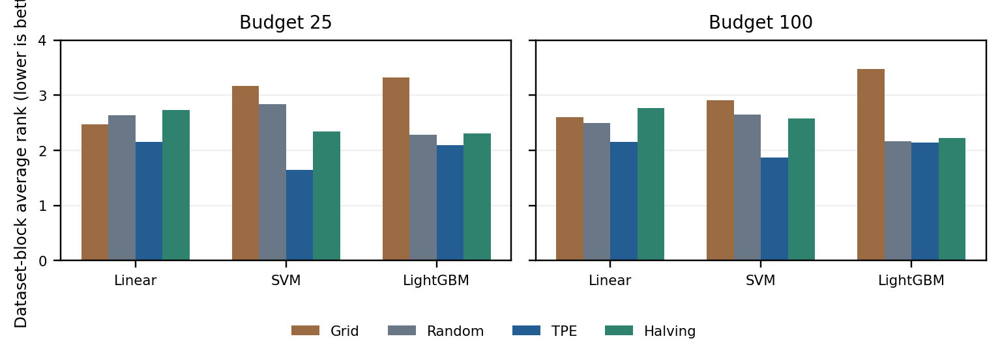
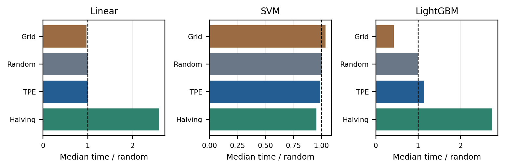
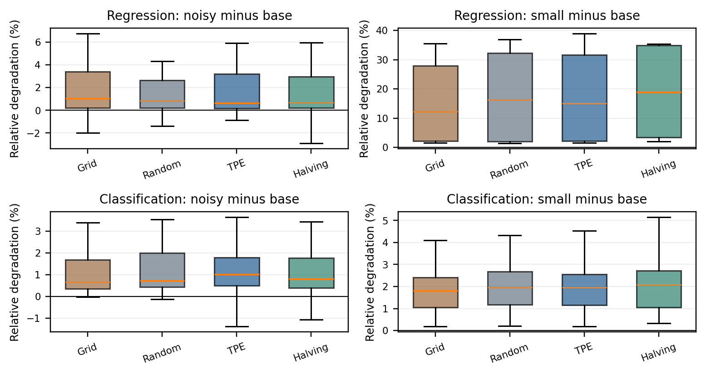

# Budgeted Hyperparameter Optimization on Tabular Data: Predictive Performance, Computational Cost, and Robustness

**MAP 6114 Machine Learning**

**Team: Optima Prime**

Danay Fernandes Alfonso  
Dilek Ozdemirci  
Ecil Teodoro

---

# Budgeted Hyperparameter Optimization on Tabular Data: Predictive Performance, Computational Cost, and Robustness

## Abstract

We compared grid search, random search, Bayesian optimization with a tree-structured Parzen estimator (TPE), and successive halving on tabular regression and classification problems. We used linear models, support vector machines with a radial basis function (RBF) kernel, and LightGBM across 51 dataset-condition-model combinations. Each combination had two search budgets and a target of five seeds. We reduced the original ten-seed plan because of computing time. The saved searches took 164.70 hours in total on a 16-core Apple M4 Max with 128 GB RAM. This total counts 1,614 unique completed runs across three code versions. The main analysis uses one consistent version, accounting for 135.72 hours and 448 of 510 planned comparisons with all four optimizers present. TPE had the best average rank in every model-budget group, with the clearest advantage for SVM. However, differences in linear-model test scores were often very small. Halving did not consistently reduce runtime, and a larger search budget did not always improve test performance. Training-label noise and smaller training samples generally made predictions worse. Missing comparisons, convergence warnings, and differences in grid construction and resource use limit these findings. We therefore report the observed scores and costs without claiming that one optimizer is statistically better overall.

**Index terms:** hyperparameter optimization; random search; Bayesian optimization; successive halving; tabular learning; computational budgets.

## I. Introduction

Choosing hyperparameters can take much longer than fitting a single model. A regularization value, kernel setting, or tree configuration may work well on one dataset and poorly on another. Our team wanted to find out when a simple search is enough and when a more adaptive method is worth the extra work.

We compared four search methods using six real datasets and four synthetic tasks. The datasets cover regression and classification, different sample sizes, many or few features, and balanced or imbalanced classes. We also changed the training data to study the effects of noise and limited sample size. Within each comparison, the optimizers used the same data split, cross-validation folds, and seed.

We focused on which method produced better test predictions, how its results changed when the search budget increased from 25 to 100, and how much time it used. We also examined variation between seeds and whether conclusions changed when we used other performance metrics. The available results answer parts of these questions, but some planned comparisons are still missing.

Computing time led us to revise the original plan. We reduced the plan from ten seeds to five, cutting the planned optimization runs from 3,060 to 1,530. The main five-seed analysis group already used 135.72 hours of recorded search time, even though its coverage is incomplete. That is 5.65 days if the runs were performed one after another. Including older code versions, the total rises to 164.70 hours, or 6.86 such days. We used a 16-core Apple M4 Max with 128 GB RAM and retained five-fold cross-validation and both search budgets.

Our original proposal described equal time budgets. The implemented experiments instead limit the number of full evaluations, or an approximate equivalent for halving, and measure elapsed time separately. This distinction matters because two methods can use similar evaluation budgets and still take very different amounts of time.

## II. Related Work

### A. Random and Bayesian search

Bergstra and Bengio [1] explain why random search is a useful alternative to a grid. When only a few hyperparameters strongly affect performance, a grid can spend many trials varying less important ones. Their findings gave us a reason to include random search as a baseline, especially for LightGBM's larger search space.

Bergstra et al. [2] describe sequential search methods that use earlier results to choose new configurations, including the approach associated with TPE. We used Optuna's TPE sampler for our Bayesian optimization experiments. Our results therefore concern this implementation, rather than every method usually called Bayesian optimization.

### B. Allocating resources during a search

Jamieson and Talwalkar [3] study hyperparameter search as a problem of identifying a promising candidate while deciding how much computation each candidate receives. Their work supports the idea behind successive halving: evaluate many candidates cheaply, then spend more on those that look promising. Whether this saves time in practice depends partly on how well the early scores predict later performance.

Li et al. [4] introduce Hyperband, which combines resource allocation with several choices about how many candidates to start and how much to spend on each. Our code uses one fixed three-stage halving schedule. We did not implement Hyperband's multiple brackets, so the halving results should not be read as Hyperband results.

### C. Tuning, evaluation, and model choice

Probst, Boulesteix, and Bischl [5] study how much different algorithms can gain from hyperparameter tuning. This is important for interpreting our ranks. A method can consistently rank first even when its actual score improvement is too small to matter much.

Bischl et al. [6] review search algorithms and practical decisions about evaluation, preprocessing, parameter ranges, and parallel execution. We followed these concerns by fitting preprocessing inside the training folds, recording the search settings, and keeping the test set separate from parameter selection. These choices make comparisons easier to check and reproduce.

Demšar [7] discusses statistical comparisons of several learning algorithms across datasets. This informed our planned Friedman and post-hoc tests and our decision not to count different seeds as independent datasets. We have not reported formal test results because our coverage and convergence checks are not yet satisfied.

Ke et al. [8] present LightGBM, an efficient gradient-boosted-tree method. Its larger parameter space gives us a useful comparison with the linear models and SVM. Optuna [9] provides our TPE search, and Scikit-learn [10] provides the other estimators, preprocessing, folds, and scoring tools. Grinsztajn, Oyallon, and Varoquaux [11] examine model performance on tabular data while accounting for tuning and differences in model assumptions. Their work supports comparing several model families, while recognizing that model properties and search-space size change together.

## III. Methodology

### A. Datasets and experiment design

We planned 19 dataset-condition combinations and 51 dataset-condition-model combinations, which we call cells. Linear models and LightGBM each have 19 cells; SVM has 13 because we excluded it from the larger datasets' Base and Noisy conditions. Each cell has four optimizers, budgets of 25 and 100, and five seeds. The design requires 1,530 optimization runs and produces 2,040 budget summaries. There are fewer runs than summaries because random search and TPE use the same search history for both budgets.

**Datasets and training conditions. Row and feature counts are source values before cleaning.**

| Dataset (OpenML ID) | Task | Rows | Features | Conditions |
| --- | --- | --- | --- | --- |
| White Wine (44971) | Reg. | 4,898 | 11 | Base, Noisy |
| Superconductivity (44964) | Reg. | 21,263 | 81 | Base, Small, Noisy |
| Communities/Crime (46286) | Reg. | 1,994 | 122 | Base, Noisy |
| Bank Marketing (1461) | Class. | 45,211 | 16 | Base, Small, Noisy |
| Bioresponse (4134) | Class. | 3,751 | 1,776 | Base, Noisy |
| Credit Default (42477) | Class. | 30,000 | 23 | Base, Small, Noisy |
| Four synthetic generators | Both | 2,000 each | 20 | Base |

Table I gives the source datasets' row and feature counts before our cleaning and encoding. For Bank Marketing, we removed call duration because it is only known after the call ends. For Communities and Crime, we removed identifiers and a fixed list of problematic attributes, then converted the remaining values to numeric form. For Credit Default, we removed the identifier and treated selected integer-coded attributes as categories. The number of inputs given to a model can therefore differ from the source feature count. We have not presented the table as a new audit of all dataset characteristics.

For each seed, we first reserved 20% of the data as a test set. Classification splits were stratified to retain the class proportions. The Base condition uses the remaining training data. The Small condition reduces the training set to 2,000 observations, with sampling stratified by class or regression-target quantiles. We used Small only for Superconductivity, Bank Marketing, and Credit Default.

In the Noisy condition, we changed training labels only. Regression targets received Gaussian noise with standard deviation $0.5s_{y,\mathrm{train}}$, where $s_{y,\mathrm{train}}$ is the training target's standard deviation. For classification, we flipped 10% of the training labels. A dataset and seed share the same clean test set across Base, Small, and Noisy, so these comparisons measure the effect of changing the training data.

Each synthetic task has 2,000 observations and 20 features. The linear regression generator has ten informative features and target-noise standard deviation 10. The Friedman generator has five informative features and noise standard deviation 1. The classification generators have five informative and five redundant features, a label-reassignment rate of 0.01, and either roughly balanced classes or nominal proportions of 90:10. We generated new data for each seed. Synthetic tasks use Base only, and their built-in generator noise is present before the split, so it affects both training and test data.

### B. Models and preprocessing

We used Elastic Net for regression and elastic-net logistic regression with the SAGA solver for classification. We refer to both as the linear-model family. SVM uses an RBF kernel, with probability estimates enabled for classification. LightGBM supplies regression and classification models based on gradient-boosted trees [8]. We restricted SVM to smaller datasets and Small conditions because of its training cost.

For numeric features, we filled missing values with the median and standardized the values. For categorical features, we used the most frequent category to fill missing values and applied one-hot encoding that can handle unseen categories. These steps were fitted separately inside each cross-validation training fold. The validation fold therefore did not influence the fitted preprocessing.

LightGBM used this same preprocessing. Although we considered its native categorical handling, we did not implement it. The models also differ in more than the number of parameters we tune. We can compare optimizer behavior across model families, but we cannot attribute every difference to search-space dimension alone.

**Hyperparameter ranges used by the searches. For halving, LightGBM tree count is set by the resource stage.**

| Model / group | Parameters and bounds |
| --- | --- |
| Linear / regression | alpha: 0.0001-100 (log); l1_ratio: 0.05-1 |
| Linear / classification | C: 0.0001-100 (log); l1_ratio: 0-1; class_weight: none/balanced |
| SVM / both | C: 0.001-1000 (log); gamma: 0.00001-1 (log) |
| SVM / task-specific | epsilon: 0.001-1 (log, regression); class_weight: none/balanced (classification) |
| LightGBM / structure | num_leaves: 8-128; max_depth: -1, 3, 5, 8, 12; min_child_samples: 5-100 |
| LightGBM / sampling | subsample: 0.5-1; colsample_bytree: 0.5-1 |
| LightGBM / boosting | learning_rate: 0.01-0.3 (log); n_estimators: 50-500 |
| LightGBM / regularization | reg_alpha and reg_lambda: 0.000001-10 (log); min_split_gain: 0-1 |

The linear models have two or three tunable parameters, SVM has three, and LightGBM has ten in the full specification. Table II lists their ranges; values marked logarithmic are sampled on a log scale. Regression Elastic Net allows up to 50,000 iterations, and classification allows 10,000. We saved convergence warnings instead of automatically removing the affected candidates. Some selected models therefore still have warnings. We report these counts and provide a separate table restricted to comparisons without selected-fit or refit warnings.

### C. Search methods and budgets

Grid search builds a rectangular grid without exceeding the budget. If a parameter receives just one value, our code uses the first category or the numeric lower bound. It does not necessarily use the model's default. Random search samples from the listed ranges. TPE uses earlier validation results to guide its next choice [2], [9]. Each method evaluates trials sequentially, but evaluates the CV folds in parallel.

Our successive-halving code starts with randomly sampled candidates and uses three resource fractions, $r\in\{1/9,1/3,1\}$. After each stage, about one third of the candidates continue. For linear models and SVM, the resource is the training-fold sample size. The subsets are nested, and the validation folds stay fixed. For LightGBM, the resource is the number of boosting rounds, reaching the upper limit of 500 at the final stage. We fit candidates again at each stage rather than continuing their earlier fitted state. Only candidates evaluated at full resource can be chosen for the final refit.

We count halving's total resource use as

$$B_{\mathrm{used}}=\sum_{j=1}^{J}r_j.$$

Here, one full evaluation means testing one configuration across all five CV folds, not fitting a model just once. The saved halving schedules use 24 and 99 full-evaluation equivalents for the nominal budgets of 25 and 100. The LightGBM grids evaluate 24 and 96 configurations. All selected LightGBM grid configurations in this snapshot have 50 trees. These details mean that equal nominal budgets do not give the methods exactly the same fitting work or parameter coverage.

Random search and TPE each run to 100 trials. We use the first 25 trials to choose their lower-budget result and refit the selected configuration separately for each budget. Grid and halving run separately at each budget because their search designs change. The two summaries from a shared history are related observations. Adding their times would count part of the same search twice.

### D. Model selection, scores, and hardware

We used five fixed cross-validation folds to choose hyperparameters. The regression measure is root mean squared error (RMSE), and classification uses the area under the receiver operating characteristic curve (ROC-AUC). Regression searches maximize negative RMSE, which is equivalent to minimizing RMSE. Classification searches maximize ROC-AUC. After selection, we refit the chosen configuration on the available training data and evaluate it on the clean test set. The saved trial history uses scores where higher is better, while regression summaries report positive RMSE.

We also recorded mean absolute error (MAE) for regression and F1, average precision (AP), and log loss for classification. F1 combines precision and recall using each estimator's default decision rule. AP summarizes the precision-recall tradeoff as the threshold changes; it is not the trapezoidal area under a precision-recall curve. Log loss evaluates predicted probabilities and penalizes confident errors.

For comparisons where lower should always mean better, we define test loss as

$$\ell=\begin{cases}\mathrm{RMSE},&\text{regression},\\-\mathrm{ROC\!-\!AUC},&\text{classification}.\end{cases}$$

The gain from a larger budget is $g=\ell_{25}-\ell_{100}$. A positive gain means the budget-100 model performed better on the test set. We define the generalization gap as test RMSE minus validation RMSE, or validation AUC minus test AUC. Positive gaps mean worse test performance. In Noisy conditions, validation uses changed training labels and testing uses clean labels, so this gap is not a pure measure of overfitting.

We ran the experiments on a 16-core Apple M4 Max with 128 GB RAM. The main analysis group records four parallel CV workers and one native model thread per worker. We did not measure whether all 16 cores were occupied. Recorded optimization time covers search and CV work, but excludes downloading and final refits. Search overhead, fitting cost, and other processes running on the machine can affect elapsed time. We did not measure CPU utilization or energy use, and multiplying elapsed hours by the core count would not give a measured CPU-hour total. Software versions are listed in Appendix A.

### E. Matching runs and comparing methods

We include a comparison only when all four optimizers have results for the same dataset, condition, model, budget, and seed. We rank their test losses from one to four, giving tied scores their average rank. To avoid giving datasets with more conditions greater weight, we average seed ranks within each condition, then conditions within each dataset. The four related synthetic generators form one synthetic-family block. The final model-budget averages use these dataset blocks. We do not average raw RMSE across datasets with different target scales.

Our planned statistical analysis uses Friedman tests across blocks, Holm correction across the six model-budget tests, and Nemenyi comparisons after a significant corrected omnibus test [7]. Before running a panel's tests, we require all planned cells and seeds, passing convergence flags for the selected trials and refits, and at least five blocks. No panel currently meets these requirements. We therefore report no formal p-values or claims of statistical significance. Even a complete study would have only seven benchmark blocks, so its statistical power would be limited and the large-sample approximations would need caution.

We also compare test performance and time through Pareto efficiency. A method is Pareto efficient in a matched group if no other method is at least as good on both test loss and time and strictly better on one. This identifies useful combinations of speed and accuracy in the observed results. It does not let us choose a method for future data by looking at that future test set.

Some plots express differences relative to the absolute value of a reference score. A relative AUC change is not a change in AUC percentage points. It also does not have the same interpretation as a relative RMSE change, so we use these plots as descriptive aids rather than a common effect-size scale.

## IV. Results

### A. Available runs

The October 30 snapshot contains 1,619 saved JSON files: 1,618 marked complete and one interrupted. They come from three source-code versions. We keep these versions separate for performance comparisons because execution settings changed and some older records lack model and convergence details.

The largest eligible group, with source hash beginning `5f5b6e60da15...`, supplies the main analysis. It was selected for coverage, not because it was necessarily the newest version. After duplicate copies are removed, it contains 1,345 completed runs and 1,793 budget summaries. Across all three versions, there are 1,614 unique completed runs. Four of the completed files are copies of existing results.

**Available comparisons with all four optimizers in the main analysis group. Dataset counts include all model cells and budgets.**

| Dataset | Available / planned | Coverage |
| --- | --- | --- |
| Bank Marketing | 56 / 70 | 80.0% |
| Bioresponse | 58 / 60 | 96.7% |
| Communities/Crime | 48 / 60 | 80.0% |
| Credit Default | 70 / 70 | 100.0% |
| Superconductivity | 56 / 70 | 80.0% |
| Balanced synthetic | 30 / 30 | 100.0% |
| Friedman | 30 / 30 | 100.0% |
| Imbalanced synthetic | 30 / 30 | 100.0% |
| Synthetic linear | 30 / 30 | 100.0% |
| White Wine | 40 / 60 | 66.7% |

We have 448 comparisons with all four optimizers, or 1,792 matched summaries, out of 510 planned groups. Coverage is therefore 87.8%. Of the dataset-condition-model-budget panels, 48 have all five seeds, 52 have four, and two have none. The missing panels are White Wine Base SVM at both budgets. Those experiments have historical files, but no results in the main code-version group. One other primary summary has no complete four-optimizer group and is left out of comparative plots.

Table III shows where coverage is missing. Average ranks may change as compatible results are added; the current values describe the available comparisons.

### B. Test performance

**Average test ranks after grouping by dataset, with seven blocks per model-budget panel. Lower ranks are better.**

| Model | B | Grid | Random | TPE | Halving |
| --- | --- | --- | --- | --- | --- |
| Linear | 25 | 2.473 | 2.642 | 2.158 | 2.728 |
| Linear | 100 | 2.596 | 2.490 | 2.148 | 2.766 |
| SVM | 25 | 3.164 | 2.839 | 1.650 | 2.346 |
| SVM | 100 | 2.914 | 2.645 | 1.864 | 2.577 |
| LightGBM | 25 | 3.320 | 2.282 | 2.088 | 2.310 |
| LightGBM | 100 | 3.471 | 2.169 | 2.136 | 2.224 |

TPE has the best average rank in all six model-budget groups in Table IV. The difference is clearest for SVM. Its ranks are 1.650 at budget 25 and 1.864 at budget 100, compared with 2.839 and 2.645 for random search. For LightGBM at budget 100, TPE, random, and halving are close: their ranks are 2.136, 2.169, and 2.224. Grid ranks last for LightGBM at both budgets, although its restricted grid and fixed 50-tree setting need to be considered when interpreting that result.

**Figure 1.** Average optimizer ranks across seven dataset blocks. Some cells have missing seeds. A rank does not show how large the score difference is.

**Example Base-condition test scores at budget 100. Mean and standard deviation (SD) use the available seeds. Regression scores are RMSE; classification scores are ROC-AUC.**

| Dataset / model | Optimizer | Seeds | Mean | SD |
| --- | --- | --- | --- | --- |
| Synthetic linear / Linear | Grid | 5 | 10.23333 | 0.37028 |
|  | Random | 5 | 10.23416 | 0.34965 |
|  | TPE | 5 | 10.22446 | 0.36416 |
|  | Halving | 5 | 10.23428 | 0.35334 |
| Synthetic linear / LightGBM | Grid | 5 | 46.78261 | 7.74061 |
|  | Random | 5 | 35.80414 | 5.19845 |
|  | TPE | 5 | 34.28479 | 6.47163 |
|  | Halving | 5 | 36.65876 | 7.04891 |
| Friedman / LightGBM | Grid | 5 | 1.42058 | 0.02528 |
|  | Random | 5 | 1.29222 | 0.03576 |
|  | TPE | 5 | 1.27173 | 0.03614 |
|  | Halving | 5 | 1.33959 | 0.03195 |
| Superconductivity / LightGBM | Grid | 4 | 9.72079 | 0.34208 |
|  | Random | 4 | 9.24376 | 0.31994 |
|  | TPE | 4 | 9.32176 | 0.40002 |
|  | Halving | 4 | 9.17557 | 0.34985 |
| Credit Default / Linear | Grid | 5 | 0.71955 | 0.00511 |
|  | Random | 5 | 0.71955 | 0.00511 |
|  | TPE | 5 | 0.71955 | 0.00511 |
|  | Halving | 5 | 0.71955 | 0.00510 |
| Bioresponse / LightGBM | Grid | 5 | 0.88306 | 0.00767 |
|  | Random | 5 | 0.88686 | 0.00643 |
|  | TPE | 5 | 0.88668 | 0.01162 |
|  | Halving | 5 | 0.88829 | 0.00945 |

The raw scores in Table V show why a better rank is not always a meaningful improvement. For synthetic linear regression with Elastic Net at budget 100, the RMSE difference across all four methods is less than 0.010. TPE gives 10.224, compared with 10.234 for random search. On the same data, LightGBM gives RMSE 34.285 with TPE and 46.783 with grid. In this example, choosing a model suited to the data matters more than choosing the optimizer. That grid result also needs to be read alongside its fixed tree count and limited parameter coverage.

For Friedman regression with LightGBM, TPE reaches RMSE 1.272. Random search gives 1.292, halving 1.340, and grid 1.421. The ordering changes on Superconductivity Base: halving has the best LightGBM mean RMSE at 9.176, followed by random at 9.244 and TPE at 9.322. TPE's better overall rank does not mean that it wins on every dataset.

The linear model on Credit Default Base gives an especially small difference: all four AUC means are about 0.71955. Ranking those scores is possible, but the ordering says little about practical improvement. Table V also includes standard deviations across seeds so the means can be considered alongside their variation.

### C. What the larger budget changed

Increasing the budget from 25 to 100 did not always improve test predictions. On regression tasks with LightGBM, TPE improved RMSE in 29 of 38 matched budget pairs, or 76.3%, with a median relative improvement of 1.27%. Random search improved in 25 of 38 pairs, or 65.8%, with the same median improvement of 1.27%. Halving improved in 16 of 38 pairs, or 42.1%, and had a median gain of zero. Its larger-budget run starts a separate search, so it does not necessarily keep the smaller run's winning candidate.

For classification with LightGBM, median relative AUC gains range from 0.055% for random search to 0.168% for halving. They improve in 25 of 47 and 31 of 47 matched pairs, respectively. Linear-model median gains are mostly zero or very close to it. SVM grid search improves on classification tasks in 25 of 29 pairs, or 86.2%, but still has a worse average rank than TPE. Figure 2 includes both improvements and declines.

**Figure 2.** Test-score changes from budget 25 to 100, relative to the magnitude of the budget-25 score. Positive values mean improvement. Boxplots use the available matched groups, with outlier markers hidden. Relative AUC and RMSE changes have different interpretations.

### D. Search time and total computing cost

**Median runtime relative to random search at budget 100, and the percentage of matched groups where each method is Pareto efficient.**

| Model | Optimizer | Time / RS | Pareto | Groups |
| --- | --- | --- | --- | --- |
| Linear | Grid | 0.97 | 56.0% | 84 |
| Linear | Random | 1.00 | 48.8% | 84 |
| Linear | TPE | 1.00 | 61.9% | 84 |
| Linear | Halving | 2.59 | 17.9% | 84 |
| SVM | Grid | 1.04 | 29.1% | 55 |
| SVM | Random | 1.00 | 49.1% | 55 |
| SVM | TPE | 0.99 | 72.7% | 55 |
| SVM | Halving | 0.96 | 61.8% | 55 |
| LightGBM | Grid | 0.43 | 94.1% | 85 |
| LightGBM | Random | 1.00 | 74.1% | 85 |
| LightGBM | TPE | 1.14 | 61.2% | 85 |
| LightGBM | Halving | 2.75 | 35.3% | 85 |

At budget 100, TPE takes about the same time as random search for the linear models, with a median ratio of 1.00. The ratio is 0.99 for SVM and 1.14 for LightGBM. Halving takes 2.59 times random-search time for the linear models and 2.75 times for LightGBM. For SVM, it is slightly faster, with a ratio of 0.96. These matched ratios are shown in Table VI.

Our halving schedule therefore did not provide a general time saving. Repeated fitting across stages, the number of candidate evaluations, and the cost of using fractional training resources may help explain this. The saved results do not separate their individual contributions.

LightGBM grid search takes only 0.43 times random-search time at budget 100. Its low time comes with the weakest average rank and the limited 50-tree grid described earlier. Yet it is Pareto efficient in 94.1% of matched groups because its speed can make it a useful tradeoff. The corresponding fractions are 74.1% for random search, 61.2% for TPE, and 35.3% for halving. These percentages count matched seed groups, while the ranks in Table IV give equal weight to dataset blocks. Their different weightings help explain why they need not produce the same ordering.

**Figure 3.** Median search time relative to random search at budget 100. The dashed line marks equal time. Our halving schedule does not generally save elapsed time.

#### Adding up the recorded time

We scanned all 1,619 result files to measure the project's recorded search time. After removing four byte-identical copies, we had 1,614 unique completed runs and one interrupted run without a timing checkpoint. For each run $i$, we took its final recorded cumulative time, $T_i=\max_j t_{ij}$. If trial timing was missing, we used the largest optimization time among its budget summaries. We then added these run times:

$$T_{\mathrm{recorded}}=\sum_i T_i.$$

We did not add cumulative timestamps within a run or add both overlapping budget summaries from random search and TPE. The audit checks duplicate run IDs against file-content hashes and keeps a ledger of the files it read.

The total is **592,915.22 seconds, or 164.70 hours**. This equals **6.86 days if the recorded runs were performed sequentially**. The main five-seed group accounts for **135.72 hours**, and older code versions account for **28.98 hours**. The interrupted run's time is unknown; it was not treated as a measured zero.

These are recorded elapsed search hours, not CPU-hours or a measured calendar duration for the project. The logs leave out downloading, preprocessing outside CV, final refits, work after the last recorded trial, and any unfinished work without a checkpoint. The full workflow required time beyond this recorded search total. If batches overlapped, their summed elapsed hours would also exceed the calendar time they occupied.

**Recorded search time by dataset, including all conditions, models, budgets, and seeds. Main refers to the group used for performance analysis; All also includes older code versions. Duplicate copies are counted once.**

| Dataset | All hours | Main hours | Share of all |
| --- | --- | --- | --- |
| Bioresponse | 130.26 | 113.56 | 79.09% |
| Bank Marketing | 13.39 | 8.02 | 8.13% |
| Superconductivity | 12.26 | 8.00 | 7.44% |
| Credit Default | 3.23 | 3.23 | 1.96% |
| White Wine | 2.98 | 0.57 | 1.81% |
| Communities/Crime | 1.46 | 1.22 | 0.89% |
| Balanced synthetic | 0.31 | 0.31 | 0.19% |
| Imbalanced synthetic | 0.30 | 0.30 | 0.18% |
| Friedman | 0.27 | 0.27 | 0.16% |
| Synthetic linear | 0.23 | 0.23 | 0.14% |
| Total | 164.70 | 135.72 | 100.00% |

Most time went to Bioresponse: **130.26 hours, or 79.09%** of the total. Bank Marketing used **13.39 hours (8.13%)**, and Superconductivity used **12.26 hours (7.44%)**. The four synthetic tasks together used only **1.11 hours**. Table VII includes the remaining datasets and separates the main analysis group from the full archive.

Bioresponse has relatively few observations but 1,776 source features. It shows why a smaller dataset is not always cheap to tune. Linear models used **104.74 hours** on Bioresponse and **123.88 hours (75.22%)** across all datasets. We cannot determine from these totals how much of that cost came from convergence behavior or particular parameter settings.

**Recorded search time by optimizer. Counts are unique completed runs. Grid and halving run separately at each budget; random search and TPE share their histories.**

| Search algorithm | Runs | All hours | Main hours | Share of all |
| --- | --- | --- | --- | --- |
| Grid | 538 | 49.37 | 39.88 | 29.98% |
| Random | 269 | 43.86 | 36.29 | 26.63% |
| Halving | 538 | 42.14 | 37.22 | 25.59% |
| TPE | 269 | 29.32 | 22.33 | 17.80% |
| Total | 1614 | 164.70 | 135.72 | 100.00% |

By search method, grid used **49.37 hours**, random search **43.86 hours**, halving **42.14 hours**, and TPE **29.32 hours** (Table VIII). These totals describe the work we recorded, rather than a controlled ranking of optimizer speed. Grid and halving have separate runs for each budget; random search and TPE share their histories. Dataset coverage, configuration costs, and execution settings also differ between code versions. Table VI's matched ratios are better suited to comparing relative runtime under the main protocol.

**Recorded search time by model family. Workloads differ, and SVM is excluded from the larger Base and Noisy conditions.**

| Model family | Runs | All hours | Main hours | Share of all |
| --- | --- | --- | --- | --- |
| Linear | 624 | 123.88 | 100.64 | 75.22% |
| SVM | 420 | 25.17 | 22.65 | 15.28% |
| LightGBM | 570 | 15.64 | 12.44 | 9.50% |
| Total | 1614 | 164.70 | 135.72 | 100.00% |

Across model families, linear models used **123.88 hours**, SVM **25.17 hours**, and LightGBM **15.64 hours** (Table IX). SVM was not run on the large Base and Noisy datasets, so its lower total cannot establish that it scales better. The main five-seed group alone already required more than five days' worth of sequential search time, which supports our decision to reduce the seed target. We have not estimated an exact ten-seed total because cost and coverage vary across seeds and experiment cells.

### E. Noise and smaller training sets

For condition comparisons, the test set stays clean and unchanged. Adding training noise generally worsens test results, although a few individual comparisons improve. Such improvements could reflect variation between repeats or changes in the configuration chosen by the search; they do not show that corrupting labels is generally useful.

For regression, the median relative loss of performance from Noisy versus Base ranges from 0.67% for TPE to 1.04% for grid, with 56 matched comparisons per method. For classification, it ranges from 0.67% for grid to 1.02% for TPE, with 64 comparisons per method.

Reducing the training sample has a larger effect on the available regression results. Median relative degradation ranges from 12.32% for grid to 18.99% for halving across 16 comparisons per method. All these regression comparisons come from Superconductivity and the two model families available in both conditions. They are not results from several independent regression datasets. Classification Small effects range from 1.81% to 2.09% across 36 comparisons per method. These pooled percentages combine repeated models and budgets and different task scales, so they should not be treated as standardized effects that can be compared directly across tasks.

**Figure 4.** Changes in clean-test performance after altering the training data. Positive values mean worse performance. Both budgets and available model cells are included; outlier markers are hidden. The Small regression comparisons use Superconductivity only.

### F. Other metrics and variation between seeds

The imbalanced synthetic SVM task shows why the choice of metric matters. At budget 100, halving has the highest mean ROC-AUC, 0.9419, and lowest log loss, 0.1435. TPE has the highest AP, 0.7859, and F1, 0.6618. Random search gives ROC-AUC 0.9382, AP 0.7742, F1 0.6492, and log loss 0.1521. The method with the highest ROC-AUC does not necessarily lead on AP, F1, or log loss. These metrics measure different aspects of prediction quality.

There is also considerable variation across the five seeds. TPE's AP standard deviation is 0.1349, and its F1 standard deviation is 0.1580, both large compared with the differences between mean scores in this example. Seed variation combines changes in data splits and search randomness. For synthetic tasks, it also includes generating a new dataset. A seed standard deviation is not a confidence interval for one fixed dataset and does not show that two optimizers are equivalent. The accompanying tables retain standard deviations and secondary metrics for every available cell.

### G. Search progress, generalization, and convergence

**Figure 5.** Best validation RMSE so far for Friedman regression with LightGBM, seed 1, budget 100. Only full-resource trials update the score, but time and resource totals include earlier low-resource work. This is one example, not a comparison of convergence rates across datasets.

Figure 5 follows Friedman regression with LightGBM at seed 1 and budget 100. We chose it as a nonlinear regression example, not because it was the most favorable seed. The curves show the best validation score so far against cumulative resource and elapsed time. For halving, only full-resource trials can update that score, but earlier trials still count toward time and resource use. We did not repeatedly evaluate the test set to build the curves. This example cannot establish a general convergence-rate ordering; the analysis exports 224 matched high-budget panels for fuller inspection.

The saved generalization tables and validation-test plots show gaps in both directions. For example, TPE's mean validation AUC on Bioresponse Base with LightGBM is 0.8738, compared with test AUC 0.8867. On Credit Default Base, the corresponding values are 0.7863 and 0.7806. Split variation and selection affect these gaps. For Noisy conditions, the difference between corrupted validation labels and clean test labels also matters.

Of the 1,793 main-group summaries, 53 flag a convergence warning for the selected trial and 37 flag a warning during the final refit. These are 2.96% and 2.06% of summaries, respectively, and all occur in the linear-model family. They are not counts of independent failed searches: the two budgets can select the same trial. SVM and LightGBM have no failing selected-trial or refit flags, although the absence of warnings does not prove that a model reached a global optimum.

The main results keep these completed fits and report the warnings. A separate sensitivity table uses only matched groups where every selected trial and refit is known to pass the convergence checks. This allows the warning-free comparisons to be inspected without silently changing which results appear in the main tables.

## V. Discussion and Limitations

The SVM results give the clearest reason to consider TPE, while the linear-model results give less reason to spend heavily on a particular search method. Their raw scores are often almost identical even when their ranks differ. Random search remains a useful baseline. LightGBM has larger tuning differences on some nonlinear regression tasks, but its preferred optimizer changes with the dataset. Finding a better validation score also does not ensure a better test score.

Some of the strongest differences are tied to how we built the searches. Our grid leaves singleton numeric parameters at their lower bounds and keeps LightGBM at 50 trees. Halving reaches 500 trees, while random search and TPE sample between 50 and 500. The methods use the same listed ranges, but do not explore the same set of candidates or spend the same fitting work per budget unit. The results describe these implemented searches. A follow-up comparison should change the grid's parameter priorities and make the tree-count and resource choices more comparable before assigning all of the difference to the search algorithm.

Missing results are another limitation. We excluded older versions with different or incomplete metadata, which left uneven coverage and no White Wine Base SVM results in the main group. This is not a random pattern of missing data. Completing the compatible runs could change the average ranks. Five seeds also give limited information about variability, and repeating splits of a real dataset does not create independent datasets. Our six real datasets are selected examples, and the four synthetic tasks are related. The study cannot establish a general causal effect of search-space dimension, label noise, or optimizer choice.

Timing has its own limits. We recorded the number of workers and threads, but not whether other jobs competed for the machine. Search time leaves out parts of the full training workflow. Earlier documentation also records a parallel-worker shutdown warning whose cause was not confirmed. That warning does not establish a memory leak or a systematic scoring failure. We retained convergence diagnostics rather than hiding them or removing affected results without explanation.

For practical use, the relevant decision is whether the observed score gain is large enough to justify its cost and variability. The Pareto results help describe that choice after the experiments, but future model selection still needs validation data. The disagreement between classification metrics also means that choosing an optimizer requires knowing which prediction outcome matters for the task.

## VI. Timeline and Teamwork Plan

Our documented Week 6 meeting was held on September 26, 2026, through Zoom. By the October 30 snapshot, the repository includes dataset loaders, preprocessing inside CV folds, model factories, and all four search methods. It also has atomic checkpoints that protect saved results, reuse of completed runs, convergence diagnostics, and an executed analysis notebook. We divided the work among the three team members as described below.

**Completed milestones and the proposed schedule for finishing the project.**

| Period | Milestone / next action |
| --- | --- |
| Week 6 / Sep. 26 | Scope and team coordination meeting (documented). |
| By Oct. 30 | Runner, saved experiments, and executed analysis implemented. |
| Oct. 30-Nov. 1 | Check report claims and submit the midterm PDF with cover letter. |
| Next course weeks | Resolve feasible coverage/convergence issues and review grid/resource semantics. |
| Weeks 13-14 | Refresh a frozen snapshot; review results, limitations, and references. |
| Week 15 | Finalize the paper and team presentation. |

Table X sets out the project milestones and the remaining schedule. Ecil Teodoro handled coding. Danay Fernandes Alfonso selected the datasets and analyzed the results. Dilek Ozdemirci analyzed the results and wrote the documentation.

## VII. Conclusion

Our results show that the value of hyperparameter search depends on the model and dataset. TPE had the best average rank at both budgets for all three model families, with its clearest advantage on SVM. However, the raw test scores tell a more specific story. The linear models often produced nearly identical scores across optimizers, while LightGBM showed larger differences on some nonlinear regression tasks. Halving performed well on certain datasets but did not consistently reduce search time. A larger search budget also failed to guarantee better test predictions.

The computing cost makes these differences important in practice. The saved searches required 164.70 hours, including 135.72 hours for the main five-seed group, on a 16-core Apple M4 Max with 128 GB RAM. This expense led us to reduce the original ten-seed target to five. Spending more time on search was useful in some experiments, but the small gains in others would be difficult to justify on accuracy alone. For the linear models, a simple search was often sufficient. For SVM, TPE gave a stronger reason to use an adaptive method. LightGBM required closer attention to the dataset and the configurations each search could actually evaluate.

These findings remain descriptive because some comparisons are missing, some linear-model fits have convergence warnings, and the LightGBM searches differ in tree count and parameter coverage. Within those limits, the study supports choosing a search method by the size and consistency of its test-score gains relative to its cost. The method with the best rank is not automatically the most useful choice when a simpler search produces almost the same predictions in less time.

## Appendix A. Reproducibility and Evidence Map

This paper uses the executed October 30 snapshot from `notebooks/03_final_analysis.ipynb`. Writing and rebuilding the report do not rerun model tuning or change experiment results. The exported tables, trajectory data, manifest, and analysis environment are in `report/data/`. The manifest, `snapshot_manifest.json`, lists the selected files and their checksums.

The main source hash is `5f5b6e60da15ed1c5be07110bdfa0c1147b0502ee46a819fca83e9e5d938fdb4`. The older groups begin `46fbb8ce4e07` and `89a4645b7b3c`. They remain separate in performance comparisons because their dataset coverage and execution or model records differ. The main experiments record NumPy 2.5.3, pandas 3.0.6, Scikit-learn 1.9.1, Optuna 5.0.0, and LightGBM 4.7.0. The analysis environment is recorded separately.

The rank table, Table IV, uses `table_03_average_ranks.csv`. The raw-score table, Table V, uses `table_02_performance.csv`, and Table VI uses `table_17_tradeoff_summary.csv`. Coverage and convergence counts come from tables 01 and 09. We calculate budget changes from `budget_gains_per_cell_seed.csv`; condition comparisons use table 12, secondary metrics table 14, and historical run counts table 21. The saved outputs also include generalization gaps, the warning-free sensitivity results, and raw differences from random search. The build script generates paper figures from these data and uses the same text and values for Markdown and LaTeX.

To repeat the time audit, run `python report/scan_runtime.py`. It reads the saved runs and writes `runtime_summary.json`, file and unique-run ledgers, and timing tables by dataset, optimizer, model, seed, and code version under `report/data/`. Older searches count toward the project's recorded computing cost, but their scores are not pooled into the main performance analysis. If the results directory changes, the timing text and tables need to be refreshed together.

To rebuild the report from the repository root, run `report/build_report.py` with Python in an environment containing pandas, NumPy, Matplotlib, Pandoc, and pdfLaTeX. The resulting `report.tex` can also be compiled directly from `report/`. Input checksums are saved in `build_manifest.json`.

The planned run count is $51\times6\times5=1530$, and the planned summary count is $51\times4\times2\times5=2040$. The 448 complete comparison groups contain 1,792 summaries, giving coverage of $448/510=87.8\%$. This coverage is different from the proportion of completed files in the directory. A legacy run that the runner can reuse is not automatically suitable for pooling into the analysis. Any new notebook snapshot requires rebuilding the paper and checking its numerical statements again.

## References

[1] J. Bergstra and Y. Bengio, "Random Search for Hyper-Parameter Optimization," Journal of Machine Learning Research, vol. 13, pp. 281-305, 2012. [Publisher / paper](https://jmlr.org/papers/v13/bergstra12a.html).

[2] J. Bergstra, R. Bardenet, Y. Bengio, and B. Kegl, "Algorithms for Hyper-Parameter Optimization," Advances in Neural Information Processing Systems, vol. 24, 2011. [Publisher / paper](https://proceedings.neurips.cc/paper/2011/hash/86e8f7ab32cfd12577bc2619bc635690-Abstract.html).

[3] K. Jamieson and A. Talwalkar, "Non-stochastic Best Arm Identification and Hyperparameter Optimization," Proceedings of AISTATS, PMLR, vol. 51, pp. 240-248, 2016. [Publisher / paper](https://proceedings.mlr.press/v51/jamieson16.html).

[4] L. Li, K. Jamieson, G. DeSalvo, A. Rostamizadeh, and A. Talwalkar, "Hyperband: A Novel Bandit-Based Approach to Hyperparameter Optimization," Journal of Machine Learning Research, vol. 18, no. 185, pp. 1-52, 2018. [Publisher / paper](https://jmlr.org/papers/v18/16-558.html).

[5] P. Probst, A.-L. Boulesteix, and B. Bischl, "Tunability: Importance of Hyperparameters of Machine Learning Algorithms," Journal of Machine Learning Research, vol. 20, no. 53, pp. 1-32, 2019. [Publisher / paper](https://jmlr.org/papers/v20/18-444.html).

[6] B. Bischl et al., "Hyperparameter Optimization: Foundations, Algorithms, Best Practices and Open Challenges," arXiv:2107.05847v3, 2021. [Publisher / paper](https://arxiv.org/abs/2107.05847).

[7] J. Demsar, "Statistical Comparisons of Classifiers over Multiple Data Sets," Journal of Machine Learning Research, vol. 7, pp. 1-30, 2006. [Publisher / paper](https://jmlr.org/papers/v7/demsar06a.html).

[8] G. Ke et al., "LightGBM: A Highly Efficient Gradient Boosting Decision Tree," Advances in Neural Information Processing Systems, vol. 30, 2017. [Publisher / paper](https://proceedings.neurips.cc/paper/2017/hash/6449f44a102fde848669bdd9eb6b76fa-Abstract.html).

[9] T. Akiba, S. Sano, T. Yanase, T. Ohta, and M. Koyama, "Optuna: A Next-generation Hyperparameter Optimization Framework," Proceedings of KDD, 2019; arXiv:1907.10902. [Publisher / paper](https://arxiv.org/abs/1907.10902).

[10] F. Pedregosa et al., "Scikit-learn: Machine Learning in Python," Journal of Machine Learning Research, vol. 12, pp. 2825-2830, 2011. [Publisher / paper](https://jmlr.org/papers/v12/pedregosa11a.html).

[11] L. Grinsztajn, E. Oyallon, and G. Varoquaux, "Why do tree-based models still outperform deep learning on tabular data?" Advances in Neural Information Processing Systems, vol. 35, pp. 507-520, 2022. [Publisher / paper](https://arxiv.org/abs/2207.08815).
